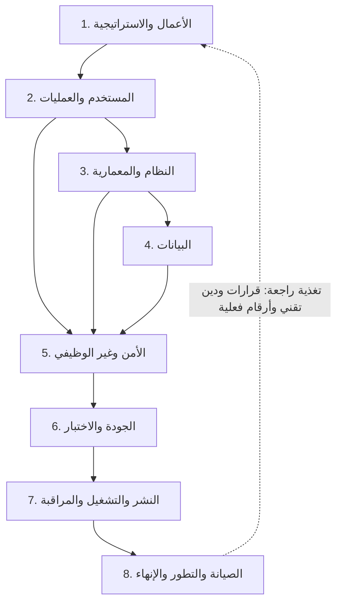

# مستويات تحليل المشاريع البرمجية

وثيقة مرجعية منهجية تصف **مستويات التحليل** التي ينتقل بها المشروع البرمجي من فكرة تجارية مجرّدة إلى نظام يعمل ويُراقَب ويُصان ثم يُتقاعد. لكل مستوى: السؤال المحوري، المدخلات، الأنشطة، المخرجات، المسؤولون، المعايير المرجعية، شرط الخروج، والأخطاء الشائعة التي تُفسده.

تعرض الوثيقة **خمسة مستويات أساسية** ثم تضيف **ثلاثة مستويات** تكمل دورة الحياة — الجودة والاختبار، النشر والتشغيل، الصيانة والإنهاء — لأن إغفالها هو أشيع سبب لفشل مشروع «تحليله سليم» على الورق. ملحق «أ» يوضّح ما تغيّر عن المسودة الأصلية وسببه، وملحق «ب» يسقط المستويات على ملفات هذا المستودع كأمثلة مرجعية.

**قراءة سريعة بحسب الحاجة**

- صورة شاملة في دقيقة: جدول المقارنة في القسم 6، وخريطة المستويات في القسم 3.
- تطبيق على مشروع قائم: مصفوفة التتبع في القسم 7، ثم قوائم التحقق في القسم 11 مستوى بمستوى.
- مراجعة نطاق تغيير في هذا المستودع: ملحق «ب»، ثم الصف المقابل للمستوى الذي يمسّه التغيير.
- فهم الخلفية والمراجع: القسمان 9 و12، ثم قائمة المراجع في نهاية الوثيقة.

## 1. نطاق الوثيقة وحدودها

**ما تغطيه الوثيقة**

- تصنيف هندسي للمستويات الثمانية بترتيب يمنع خلط متطلبات الأعمال بالتفاصيل التقنية.
- القالب الموحّد لكل مستوى: مدخلات، هدف، أنشطة، مخرجات، مسؤول، معيار مرجعي، شرط خروج، أخطاء شائعة.
- أدوات الربط بين المستويات: مصفوفة التتبع، مصفوفة المسؤوليات، وقوائم تحقق تنفيذية.

**ما لا تغطيه**

- لا تصف سلوك أي مكوّن من مكوّنات هذا المستودع ولا تَعِد بتشغيل أو تنفيذ؛ ملحق «ب» إسقاط مرجعي على الملفات القائمة فقط.
- لا تفرض منهجية إدارة مشروع بعينها: المستويات **تتابع منطقي لا زمني بالضرورة**. يمكن أن تُمرَّر كاملة داخل كل دورة تسليم، أو أن تُحدَّث جزئيًا في كل إصدار.
- لا تُغني عن المعايير المشار إليها في القسم 9؛ هي مدخل إليها لا بديل عنها.
- لا تصلح كدليل قرار وحده في السياقات المنظَّمة (طبية، مالية، حكومية) دون الرجوع إلى الالتزامات التنظيمية الملزمة.

**مبدأ الاستخدام:** مرّر المستويات بالترتيب أول مرة، ثم حدِّث ما تغيّر فقط في كل دورة. القفز إلى مستوى أدنى دون أصل أعلى يُنتج متطلبات يتيمة يصعب الدفاع عنها لاحقًا.

## 2. المبادئ الحاكمة

| المبدأ                           | المعنى الهندسي                                                                         | ما يمنعه                                                        |
| -------------------------------- | -------------------------------------------------------------------------------------- | --------------------------------------------------------------- |
| التدرّج من المجرّد إلى الملموس   | يبدأ التحليل بسؤال القيمة وينتهي بحدود التشغيل والقياس                                 | البدء بالتقنية قبل معرفة المشكلة                                |
| الفصل بين «لماذا» و«ماذا» و«كيف» | المستويان 1-2 يجيبان عن لماذا/ماذا ولمن، والمستويان 3-4 عن كيف، والمستوى 5 عن بأي حدود | خلط متطلبات الأعمال بتفاصيل التنفيذ                             |
| التتبّع الثنائي                  | كل مخرج أعلى يتحول إلى إدخال معرَّف أدناه، وكل مخرج أدنى يُشتق من أصل أعلى             | المتطلبات اليتيمة والمكوّنات بلا سبب                            |
| بوابات الانتقال                  | لا يُغلق مستوى قبل تحقق شرط خروجه المكتوب                                              | الانتقال بافتراضات غير مُعلنة                                   |
| القابلية للتحقق                  | كل مخرج له معيار قبول قابل للقياس أو الملاحظة، لا وصف عام                              | «سريع» و«آمن» و«سهل» بلا رقم أو اختبار                          |
| التوثيق بمالك                    | لكل مخرج مالك ومعيار تحديث وإلا فقد قيمته                                              | وثائق ميتة تصف نظامًا لم يعد موجودًا                            |
| التكرار المضبوط                  | المستويات تُمرَّر كل دورة، والقرارات تُسجَّل بأسبابها وبدائلها المرفوضة                | «الشلال المتجمد» و«التفصيل الكامل قبل أول سطر»                  |
| حدود الثقة مفروضة                | الأمن متطلب مقروء في كل مستوى: من يملك ماذا، وما الجهة الموثوقة وما غيرها              | تصوّر أن الشبكة الداخلية موثوقة، وتأجيل الأمن إلى نهاية المشروع |

## 3. خريطة المستويات

المسار الأصلي للتحليل كان خطًا واحدًا من الأعمال إلى الأمن:

```text
[مستوى الأعمال] ──> [مستوى المستخدم والعمليات] ──> [مستوى النظام والمعمارية] ──> [مستوى البيانات] ──> [المستوى الأمني وغير الوظيفي]
```

وتضيف هذه الوثيقة ثلاث حلقات تكمل الدورة بعد الأمن: الجودة والاختبار، ثم النشر والتشغيل والمراقبة، ثم الصيانة والتطور والإنهاء، مع تغذية راجعة تعود إلى مستوى الأعمال:



يلاحظ أن المستوى 5 يستقبل مدخلات من ثلاثة مستويات سابقة: من العمليات يأخذ المسارات الحرجة، ومن المعمارية حدود الثقة وأنماط الفشل، ومن البيانات تصنيف المعلومات وحدود الاحتفاظ والاستعادة.

## 4. المستويات الأساسية

### المستوى 1 — تحليل الأعمال والاستراتيجية

**السؤال المحوري:** هل يستحق هذا المشروع أن يُبنى؟ ولمن، وبأي عائد، وبأي حدود؟

**الهدف الهندسي:** تثبيت الجدوى والهدف والنطاق قبل أي قرار تقني، وتحويل «الفكرة» إلى التزام موقّع له رقم ومالك.

**المدخلات:** فكرة المنتج، بيانات السوق والمنافسين، قيود الميزانية والزمن، الالتزامات التنظيمية، قدرات الفريق الحالية والواقعية.

**الأنشطة الرئيسية:**

- تحديد أهداف العمل ومؤشراتها القابلة للقياس (KPI أو OKR بزمن وهدف ومصدر بيانات).
- تحليل الجدوى: اقتصادية، تقنية مبدئية، تشغيلية، قانونية وتنظيمية.
- تحليل أصحاب المصلحة ومصفوفة القرار: من يوقّع، ومن يؤثر، ومن يستخدم، ومن يعطّل.
- تثبيت النطاق الصريح وداخله وخارجه، مع الافتراضات والقيود مكتوبة لا مضمرة.
- قرار البناء أو الشراء أو التبني مع تقدير جهد تقريبي ونطاق ثقة معلن.
- سجل مخاطر أولي مع مالك لكل خطر وخطة تخفيف لأعلى المخاطر.

**المخرجات ومعايير القبول:**

| المخرج              | الشكل العملي                                 | شرط القبول                                    |
| ------------------- | -------------------------------------------- | --------------------------------------------- |
| مذكرة الجدوى        | صفحة إلى ثلاث صفحات مع أرقام العائد والتكلفة | كل رقم له مصدر، وكل افتراض معلن               |
| وثيقة النطاق        | قائمتا «داخل النطاق» و«خارج النطاق»          | موقّعة من صاحب قرار معروف                     |
| قائمة أصحاب المصلحة | جدول: دور، تأثير، مصلحة، طريقة التواصل       | كل مخرج رئيسي له مالك مفرد                    |
| مؤشرات النجاح       | مؤشرات بزمن وهدف ومصدر بيانات                | قابلة للقياس بعد الإطلاق لا بعده فقط          |
| سجل المخاطر الأولي  | جدول: خطر، احتمال، أثر، تخفيف، مالك          | أعلى المخاطر لها فعل تخفيف مجدول، لا نيّة فقط |

**شرط الخروج:** الإجابة عن «لماذا» و«لمن» و«إلى أين» بأرقام موافَق عليها، ويستحيل بدء التصميم بلا صاحب قرار ونطاق مكتوب.

**أخطاء شائعة:** استبدال تحليل الأعمال بقرار تقني («سنستخدم كذا»)، أهداف مقياسها غير موجود، نطاق «كل شيء»، تفاؤل التقدير، وكتابة مذكرة الجدوى بعد النجاح لتبريره بدل تحليله قبله.

**المعايير المرجعية:** ISO/IEC/IEEE 12207 (تحليل المهمة أو الأعمال)، BABOK، TOGAF ADM المرحلة A، وممارسات الحوكمة والمخاطر في PMBOK.

### المستوى 2 — تحليل المستخدم والعمليات

**السؤال المحوري:** من يفعل ماذا، بأي خطوات، وبأي شروط يُعدّ العمل ناجحًا أو فاشلًا؟

**الهدف الهندسي:** تحويل أهداف الأعمال إلى متطلبات وظيفية قابلة للاختبار ومسارات عمل واضحة، بحيث لا يبقى سلوك النظام موضع تخمين.

**المدخلات:** النطاق والأهداف المعتمدة من المستوى الأول، خبرة المستخدمين الفعليين، وصف العمليات القائمة.

**الأنشطة الرئيسية:**

- تعريف شرائح المستخدمين وممثليهم (Personas) بصلاحياتهم وقيودهم الواقعية.
- كتابة قصص المستخدمين بصيغة «كـ… أريد… حتى…» مع معايير قبول قابلة للاختبار، وصفًا لسيناريو النجاح والفشل معًا.
- كتابة حالات الاستخدام للمسارات المركّبة، بما فيها الاستثناءات ومسارات التعافي، لا المسار السعيد وحده.
- رسم رحلة المستخدم ونقاط الاحتكاك، وتوصيف سير العمل الحالي والمستهدف (مثل BPMN) وقواعد العمل الصريحة.
- ترتيب الأولوية (MoSCoW أو Kano) بحسب قيمة المستخدم لا بحسب سهولة التنفيذ وحدها، وتحديد الحد الأدنى القابل للإطلاق.
- تمثيلات مبدئية (Wireframes) لاختبار الفهم قبل البناء.

**المخرجات ومعايير القبول:**

| المخرج                      | الشكل العملي                                    | شرط القبول                                             |
| --------------------------- | ----------------------------------------------- | ------------------------------------------------------ |
| سجل المتطلبات الوظيفية      | معرّف ثابت لكل متطلب مع وصف ومعيار قبول وأولوية | كل متطلب مرتبط بمستخدم وبهدف أعمال أصلي                |
| قصص المستخدم ومعايير القبول | قصة + معايير قبول بصيغة معطى/عندما/إذن          | لا قصة بلا معيار قبول قابل للاختبار، ولا معيار بلا قصة |
| مخططات سير العمل            | مخططات الحالة الحالية والمستهدفة                | كل خطوة لها مدخل ومخرج ومالك وقاعدة                    |
| خرائط رحلة المستخدم         | رحلة تشمل نقاط الفشل والتعافي                   | كل نقطة احتكاك لها قرار: نحلّها أو نقبلها صراحة        |
| قاموس مصطلحات المجال        | مصطلح واحد لكل مفهوم مع تعريف ملزم              | لا مصطلحان لنفس المفهوم في المتطلبات                   |

**تنبيه هندسي:** قصص المستخدم وحالات الاستخدام أداتان مختلفتان لا بديلتان: القصة وحدة تخطيط قصيرة تُدار في اللوحة، وحالة الاستخدام وصف كامل لسيناريو بما فيه الاستثناءات. استخدام القصة وحدها في مسار معقّد يُنتج فراغًا في السلوك.

**شرط الخروج:** كل متطلب وظيفي معرَّف ومرتَّب بمقياس أولوية معلن، وله معيار قبول قابل للاختبار، ومربوط بمستخدم وفائدة؛ وسلوك الأخطاء والحالات الحدّية مكتوب لا مفترض.

**أخطاء شائعة:** قصص بلا معايير قبول، تحويل واجهة قديمة إلى متطلبات (تثبيت سوء تصميم سابق)، إغفال المستخدم الرقابي أو الجهة الخارجية، متطلبات غير مربوطة بأصل أعمالي، والسكوت عن الأخطاء والاستثناءات حتى تظهر في الإنتاج.

**المعايير المرجعية:** ISO/IEC/IEEE 29148 (هندسة المتطلبات)، BPMN 2.0 لسير العمل، وBABOK في تحليل الحلول.

### المستوى 3 — تحليل النظام والمعمارية

**السؤال المحوري:** كيف تُبنى هذه المتطلبات كنظام مفهوم الحدود، قابل للتوسع والتغيير والاختبار؟

**الهدف الهندسي:** تحويل المتطلبات الوظيفية وغير الوظيفية إلى هيكل تقني ومكوّنات وحدود مسؤولية وعقود تكامل، مع تسجيل كل قرار كبير وبدائله المرفوضة.

**المدخلات:** سجل المتطلبات وأولوياتها، المسارات الحرجة، قيود الفريق والميزانية والتشغيل، وحدود الأداء والزمن المتوقعة.

**الأنشطة الرئيسية:**

- تحديد حدود النظام والسياق الخارجي: ما داخل مسؤولية النظام وما خارجها، ومن الجهات التي يتكامل معها.
- وصف المعمارية على مستويات متدرجة (مثل C4: السياق ثم الحاويات ثم المكوّنات) بحيث يُقرأ المخطط بمستوى التفصيل المطلوب لا أكثر.
- صياغة المتطلبات غير الوظيفية كسيناريوهات جودة: مصدر الضغط، المقياس، ظرف القياس، والقيمة المقبولة.
- اختيار التقنيات بعقود مجردة عند حدود النظام (Interfaces) بحيث لا تنتقل تفاصيل المكتبة إلى بقية الكود، وتسجيل البدائل المرفوضة في سجل قرارات معماري (ADR).
- تصميم التكاملات: عقد الواجهة، النسخ، المصادقة، المهلات، إعادة المحاولة، ومنع التكرار (Idempotency) وسلوك الفشل الجزئي.
- مخططات تدفق البيانات العامة (DFD) على مستوى الحاويات: من أين تأتي البيانات وإلى أين تذهب ومن يخزّنها.
- تحليل أنماط الفشل وتخطيط القدرة بفرضيات نمو معلنة.

**المخرجات ومعايير القبول:**

| المخرج                     | الشكل العملي                         | شرط القبول                                          |
| -------------------------- | ------------------------------------ | --------------------------------------------------- |
| مخططات المعمارية           | مخطط سياق وحاويات ومكوّنات           | كل مكوّن له مسؤولية مفردة معلنة                     |
| سجل قرارات المعمارية (ADR) | قرار، سياق، بدائل مرفوضة، سبب، تاريخ | لا قرار هيكلي بلا سبب مكتوب وبديل مذكور             |
| عقود الواجهات              | مواصفة عقد لكل تكامل مع أخطاء معرّفة | كل خطأ له شكل ثابت وحدود معلنة للمستهلك             |
| مخططات تدفق البيانات       | DFD للمستوى العام                    | كل مخزن بيانات معروف ومصنَّف وله مالك               |
| مصفوفة متطلب ← مكوّن       | جدول ربط                             | لا متطلب بلا مكوّن مسؤول ولا مكوّن بلا متطلب يبرّره |

**شرط الخروج:** كل متطلب مرتبط بمكوّن مسؤول، وكل قرار معماري كبير له سجل بقرار وبديل مرفوض وسبب، وحدود الثقة ومصادر الحقيقة المعلنة واضحة لمن سيصون النظام.

**أخطاء شائعة:** «النظام كله في مكوّن واحد» بلا شرح للتسويات، اختيار التقنية بالشعبية أو بالعادة، تفصيل المخططات قبل استقرار المتطلبات، تكامل بلا عقد وبلا سياسة نسخ، وتصميم لا يجيب عن سؤال «ما الذي يحدث عند فشل الاعتماد؟»، ومعمارية لا تذكر قيود النشر والحدود المجانية أو التراخيص.

**المعايير المرجعية:** ISO/IEC/IEEE 42010 (وصف المعمارية)، TOGAF وArchiMate، وSWEBOK في تصميم البرمجيات ومعماريتها.

### المستوى 4 — تحليل البيانات

**السؤال المحوري:** ما المعلومات التي يحتفظ بها النظام، ومن يملكها، وكيف تنشأ وتُقرأ وتُحمى وتُستعاد وتُتلف؟

**الهدف الهندسي:** تصميم نموذج بيانات يحقّق سلامة المعلومات ويخدم أنماط الاستعلام المتوقعة، ضمن سياسات احتفاظ وحماية قابلة للتدقيق.

**المدخلات:** المتطلبات الوظيفية وقواعد العمل، مخططات تدفق البيانات، تصنيف المعلومات والالتزامات التنظيمية، وتقديرات النمو.

**الأنشطة الرئيسية:**

- استخراج الكيانات والعلاقات وتحديد المفاتيح والقيود والفروق بين السجلات (Entity-Relationship Modeling).
- تصميم المخططات والمؤشرات انطلاقًا من أنماط الاستعلام المتوقعة أولًا، لا من الشكل الجمالي للجداول.
- تصنيف البيانات (عامة، داخلية، شخصية، حساسة) وتحديد مالك لكل حقل ومصدر حقيقة واحد لكل مفهوم.
- تعريف دورة حياة البيانات: الإنشاء، التعديل، الأرشفة، الحذف، الإتلاف — لكل حالة أثرها على النسخ والتحليلات.
- سياسات الاحتفاظ والنسخ الاحتياطي والاستعادة مع أهداف زمن الاستعادة (RTO) وزمن فقد البيانات المقبول (RPO).
- تقدير الحجم والنمو وضغط الكتابة والقراءة، وتحديد أين يصبح النمو مشكلة (عنق زجاجة أو كلفة).
- استراتيجية الترحيل (Migration) ومسار الرجوع الآمن عند فشلها.
- قواعد جودة البيانات: ما يُرفض عند الإدخال، وما يُصحَّح لاحقًا، وكيف يُكتشف الشاذ.

**المخرجات ومعايير القبول:**

| المخرج                | الشكل العملي                             | شرط القبول                                               |
| --------------------- | ---------------------------------------- | -------------------------------------------------------- |
| مخطط الكيانات (ERD)   | كيانات وعلاقات ومفاتيح وحدود             | كل علاقة لها معنى وقيود سلامة واضحة                      |
| قاموس البيانات        | جدول: حقل، نوع، قيود، تصنيف، مالك، دلالة | لا حقل بلا مالك وتصنيف                                   |
| سيناريوهات استعلامات  | الاستعلامات الحرجة المتوقعة مع حجمها     | كل استعلام حرج له فهرس مبرَّر أو تسوية موثقة             |
| سياسة الاحتفاظ والنسخ | مدد الاحتفاظ، دورية النسخ، RTO/RPO       | الاستعادة مجرّبة فعليًا ونتيجتها مسجّلة، لا موثقة نظريًا |
| خطة الترحيل           | خطوات، تحقق مسبق، مسار تراجع             | كل ترحيل قابل للتراجع أو مصحوب بنسخة قابلة للاستخدام     |

**شرط الخروج:** كل حقل معرَّف بنوعه وقيوده ومالكه وتصنيفه؛ ويمكن الإجابة بوضوح عن «أين تعيش البيانات الشخصية، ومن يصل إليها، ومتى تُمحى؟»؛ وخطة الاستعادة أثبتت نجاحها بالتجربة.

**ملاحظة على التسويات:** التطبيع والتجريد ليسا هدفين بل مقايضة: التطبيع يكسب سلامة البيانات ويخسر بعض سرعة القراءة، والعكس مع السلاسة (Denormalization). القرار يُسجَّل مع سببه، ويُراجَع عند تغيّر نمط الاستخدام.

**أخطاء شائعة:** تخزين كل شيء في حقول عامة مفتوحة بلا حوكمة، تصميم المخطط قبل معرفة الاستعلامات، تجاهل الحجم والنمو، نسخة احتياطية لم تُجرَّب استعادتها، نصوص حساسة بلا تشفير، والاحتفاظ الأبدي ببيانات لا حاجة ولا سند تنظيمي لها.

**المعايير المرجعية:** DAMA-DMBOK في إدارة البيانات، مبادئ الخصوصية المعمول بها في النطاق القانوني للمشروع، وممارسات النمذجة في SWEBOK.

### المستوى 5 — التحليل الأمني وغير الوظيفي

**السؤال المحوري:** ما حدود النظام المقبولة في الأداء والموثوقية والأمان وإمكانية الوصول، وكيف نقيسها ونراقبها؟

**الهدف الهندسي:** تحويل صفات الجودة من نوايا غائمة إلى أرقام وقياسات وحالات فشل معروفة، وحماية النظام والمعلومات ضمن نموذج تهديد مكتوب.

**المدخلات:** المسارات الحرجة من مستوى العمليات، حدود الثقة وأنماط الفشل من المعمارية، تصنيف البيانات وسياسات الاحتفاظ من مستوى البيانات، والالتزامات التنظيمية.

**الأنشطة الرئيسية — الصفات غير الوظيفية:**

- صياغة كل متطلب غير وظيفي بصيغة: مقياس + ظرف + قيمة هدف + طريقة قياس (مثال: زمن استجابة عند الشريحة المئوية 95 لا يتجاوز حدًّا معينًا لطلب محدد عند حمل معلوم، يُقاس بأداة معلومة).
- تصنيف صفات الجودة على ISO/IEC 25010: الأداء والكفاءة، الموثوقية، الأمان، قابلية الاستخدام وإمكانية الوصول، قابلية الصيانة، قابلية النقل والتوافق.
- تحديد أهداف مستوى الخدمة (SLO/SLI) وميزانية الخطأ، وربطها بلوحة مراقبة لا بوثيقة فقط.
- تصميم التدهور المنضبط: مهلات، حدود تزامن، إعادة محاولة بحدود، قواطع دائرة، ورفض صريح بدل تعليق.
- استمرارية الأعمال: ماذا يعمل عند فقد اعتماد رئيسي، وما هدف الاستعادة، وكيف يُختبر ذلك دوريًا.

**الأنشطة الرئيسية — الأمن:**

- نموذج تهديد مكتوب على حدود الثقة (منهج مثل STRIDE) مع تصنيف كل تهديد: مُعالَج أو مقبول صراحة.
- حالات سوء الاستخدام (Abuse Cases) بجانب حالات الاستخدام: كيف يُساء استخدام هذه الميزة؟
- المصادقة والتفويض: مبدأ أقل صلاحية، فصل الأدوار، ومسار تصعيد إداري موثّق.
- إدارة الأسرار: لا أسرار في الشيفرة أو السجلات أو صور البناء، وتدوير قابل للتنفيذ.
- التشفير أثناء النقل والتخزين، والتحقق من المدخلات، وتعميم المخرجات لمنع الحقن والتسريب.
- سلسلة التوريد: مصدر الاعتماديات، تثبيت الإصدارات، فحص الثغرات، وسياسة تحديث.
- سجلات تدقيق تمنع الإنكار، مع حفظ مناسب وبلا بيانات حساسة زائدة.

**المخرجات ومعايير القبول:**

| المخرج                       | الشكل العملي                             | شرط القبول                                             |
| ---------------------------- | ---------------------------------------- | ------------------------------------------------------ |
| وثيقة المتطلبات غير الوظيفية | جدول: صفة، مقياس، ظرف، هدف، أداة قياس    | لا صفة بلا رقم وطريقة قياس                             |
| نموذج التهديد                | حدود ثقة، تهديدات، معالجة، متبقٍ مقبول   | كل حد ثقة مغطى، والقبول المتبقي موقّع من مالك المخاطرة |
| خطة الاستمرارية              | سيناريوهات فشل، RTO/RPO، إجراءات استعادة | نُفّذ اختبار استعادة واحد على الأقل ونتيجته مسجّلة     |
| أهداف مستوى الخدمة           | مؤشرات، أهداف، ميزانية خطأ، لوحة         | كل هدف مربوط بمصدر قياس فعلي                           |
| سياسة المصادقة والتفويض      | أدوار، صلاحيات، مسار طلب صلاحية          | لا صلاحية دائمة أوسع من الحاجة                         |

**شرط الخروج:** كل متطلب غير وظيفي له رقم وقياس ومصدر بيانات؛ والمسار الحرج له هدف موثوقية معلن؛ ولا سر خام في الشيفرة أو السجلات؛ وكل حد ثقة في نموذج التهديد إما مُعالَج أو مقبول كتابةً.

**أخطاء شائعة:** صفات غائمة بلا قياس، إضافة الأمن في النهاية، اعتبار الشبكة الداخلية موثوقة، تجاهل حدود النمو عند وجود مكوّن أحادي الكتابة أو خدمة مشتركة، وإهمال إمكانية الوصول والترجمة كمتطلبات غير وظيفية حقيقية.

**المعايير المرجعية:** ISO/IEC 25010 (نموذج الجودة)، ISO/IEC 27001 و27002 (إدارة أمن المعلومات)، OWASP ASVS وضوابط OWASP الاستباقية، ISO 22301 (استمرارية الأعمال)، وWCAG لإمكانية الوصول.

## 5. المستويات المضافة: الجودة والتشغيل والصيانة

المستويات الثلاثة التالية تُغلق دورة الحياة. غيابها في أي تحليل يعني أن المشروع مُخطَّط للبناء فقط، لا للاستمرار: لا أحد يعرف كم يكلف التأكد من صحته، ولا كيف يصل إلى المستخدمين، ولا كيف يتقاعد دون أن يترك بيانات وصلاحيات معلّقة.

### المستوى 6 — تحليل الجودة والاختبار

**السؤال المحوري:** كيف نعرف أن ما بُني يطابق ما وُصف، وكيف نمنع الانحدار عند التغيير؟

**الهدف الهندسي:** تحويل معايير القبول إلى تحقق قابل للتكرار، وتوزيع جهد الاختبار بحسب المخاطر لا بحسب التفاصيل.

**المدخلات:** معايير القبول من مستوى المستخدم، حدود المكوّنات والعقود من المعمارية، سياسات البيانات، وصفات الجودة والتهديدات من المستوى الخامس.

**الأنشطة الرئيسية:**

- بناء استراتيجية اختبار مبنية على المخاطر: ما الذي يُكلّف فشله أكثر، يُختبَر أعمق.
- اختيار مستويات الاختبار: وحدة، تكامل بين المكوّنات، اختبار عقود، قبول، وتحميل أو اختبار استرجاع عند الحاجة، مع توزيع مبرَّر لا متساوٍ.
- كتابة حالات الاختبار من معايير القبول مسبقًا، لا بعد البناء.
- تعريف «منجز» (Definition of Done) وبوابات الجودة: ما الذي يجب أن ينجح قبل الدمج، وما الذي يجب أن يعمل يدويًا وبإعلان صريح فقط.
- عزل الاعتماديات في الاختبارات المعتادة (بدائل وقواعد حقيقية محلية) بحيث لا يحتاج القبول اليومي شبكة أو خدمة خارجية؛ والفحوص الحيّة تُشغَّل صراحة وبإعلان.
- تصنيف العيوب بدرجة الأثر، وربط معايير الإصلاح بها، وتتبّع العيوب المتكررة إلى أصلها التحليلي.
- بيانات اختبار معزولة ومُصنَّعة: لا بيانات إنتاج شخصية في بيئة اختبار.

**المخرجات ومعايير القبول:**

| المخرج                     | الشكل العملي                                      | شرط القبول                                                        |
| -------------------------- | ------------------------------------------------- | ----------------------------------------------------------------- |
| مصفوفة معيار قبول ← اختبار | جدول يربط كل معيار قبول باختبار آلي أو إجراء يدوي | لا معيار قبول بلا تحقق معلن                                       |
| استراتيجية اختبار          | نطاق، مستويات، مخاطر، بيانات، بيئات               | كل مستوى مخاطرة عالية له تحقق آلي على الأقل                       |
| بوابات الجودة              | قائمة فحوص إلزامية قبل الدمج والنشر               | البوابة تعمل من مستودع نظيف بأمر واحد                             |
| عقد اختبار مشترك           | سلوك واحد يُختبَر عبر كل تنفيذ للعقد نفسه         | أي تنفيذ جديد للعقد يرث نفس الاختبارات بالوراثة لا بإعادة الكتابة |
| تقرير جودة دوري            | عيوب مفتوحة، تغطية، مخاطر متبقية                  | الاتجاه يُقرأ من البيانات لا من الانطباع                          |

**شرط الخروج:** كل معيار قبول له تحقق معلن؛ والاختبارات المعتادة تعمل بلا خدمات خارجية؛ ولا اختبار يعتمد على الشبكة دون إعلان صريح؛ ورسالة الفشل تشرح السبب لا رقم سطر فقط.

**أخطاء شائعة:** قياس الجودة بنسبة تغطية واحدة، اختبارات هشّة مرتبطة بتفاصيل التنفيذ، فحوص حيّة داخل خط الأتمتة، «يعمل على جهازي» بلا بيئة موحّدة، ومعايير قبول تُختبَر شفهيًا فتضيع عند تغيّر الفريق.

**المعايير المرجعية:** ISO/IEC/IEEE 29119 (اختبار البرمجيات)، ISTQB في مصطلحات ومستويات الاختبار، وممارسات الجودة في SWEBOK.

### المستوى 7 — تحليل النشر والتشغيل والمراقبة

**السؤال المحوري:** كيف يصل النظام إلى المستخدمين، ويتحمل الحمل، ويعود بعد العطل، وبأي كلفة؟

**الهدف الهندسي:** جعل الوصول إلى الإنتاج مسارًا قابلًا للتكرار والتراجع، وحالة النظام مقروءة من القياس لا من الشكوى.

**المدخلات:** حدود المكوّنات والاعتماديات، أهداف مستوى الخدمة والموثوقية، قيود الميزانية والحصص (حدود مجانية أو تراخيص أو حصص مزوّد)، وخصائص البيانات والتخزين.

**الأنشطة الرئيسية:**

- خط تسليم من المستودع إلى البيئات ببوابات تحقق قبل النشر (فحص، اختبار، بناء، فحص ثغرات)، وبلا خطوات سرية شفهية.
- فصل البيئات (تطوير، اختبار، إنتاج) مع إدارة إعدادات وأسرار مستقلة لكل بيئة، ومصدر حقيقة واحد للإعداد.
- نشر قابل للتكرار: إما بنية كتحصيل كود (IaC) أو سكربتات معلومة، مع فرق واضح بين ما يُبنى مرة وما يُعدَّل لكل بيئة.
- استراتيجية إصدار وتراجع: كيف يُطرح التغيير تدريجيًا، وكيف يُستَرجع الإصدار السابق، ومتى يُعلَن التراجع.
- المراقبة والتشخيص: سجلات منظّمة بمعرّف طلب، ومقاييس، ولوحات مربوطة بأهداف مستوى الخدمة.
- التنبيهات: كل تنبيه له مالك وإجراء محدَّد وحد ضجيج؛ التنبيه الذي لا يُتصرَّف به عبء لا حماية.
- دفاتر التشغيل (Runbooks) للحالات المتوقعة: ماذا يفعل المناوب عند توقف اعتماد، أو امتلاء تخزين، أو بلوغ حصة.
- إدارة الحوادث: تصنيف الشدة، قنوات التصعيد، ومراجعة بعد الحادث بلا لوم تُنتج فعلًا قابلًا للتنفيذ.
- متابعة الكلفة والقدرة: أين يتحول النمو إلى عنق زجاجة أو إلى فاتورة، وما حدود الحصص التعاقدية.

**المخرجات ومعايير القبول:**

| المخرج             | الشكل العملي                  | شرط القبول                                       |
| ------------------ | ----------------------------- | ------------------------------------------------ |
| خط النشر           | ملفات أتمتة + خطوات موثقة     | النشر من مستودع واحد بلا معرفة شفهية             |
| خطة التراجع        | متى نتراجع، وكيف، ومن يقرر    | التراجع مجرَّب في بيئة غير إنتاجية مرة على الأقل |
| حزمة المراقبة      | لوحات، مقاييس، سجلات، تتبّع   | كل هدف خدمة له مؤشر ظاهر على لوحة                |
| قائمة التنبيهات    | تنبيه، شرط، شدة، إجراء، مالك  | لا تنبيه بلا إجراء معروف                         |
| دفاتر التشغيل      | خطوات للحالات الشائعة والخطرة | مناوب جديد ينفّذها بلا سؤال                      |
| سجل الكلفة والقدرة | حجم، استهلاك، حصص، حد نمو     | حد النمو معلن مع قرار مسبق عند بلوغه             |

**شرط الخروج:** النشر والتراجع قابلان للتنفيذ من المستودع وحده؛ وكل خدمة حرجة لها لوحة وتنبيه ودليل تشغيل؛ والأسرار في مخزن أسرار لا في المستودع؛ وحدود الحصص والكلفة معلومة قبل الإطلاق لا بعده.

**أخطاء شائعة:** نشر بخطوات يدوية غير موثقة، «تم النشر بنجاح» بلا سجل لما تغيّر، تنبيهات لا يقرأها أحد، مراقبة بلا هدف خدمة معلن فلا يُعرف معنى «سليم»، وإغفال أثر الحدود المجانية أو التراخيص أو الحصص على التصميم نفسه.

**المعايير المرجعية:** ITIL 4 في إدارة الخدمة والحوادث، ممارسات موقع الموثوقية (SRE) في أهداف الخدمة وميزانية الخطأ، وISO/IEC/IEEE 12207 في عمليات التشغيل.

### المستوى 8 — تحليل الصيانة والتطور والإنهاء

**السؤال المحوري:** كيف يبقى النظام صالحًا بعد الإصدار الأول، وكيف يُتقاعد بأمان؟

**الهدف الهندسي:** جعل الكلفة المستقبلية مرئية ومُدارة: التغيير ممكن، والاعتماديات متجدّدة، والإنهاء منظّم بلا مخلفات أمنية أو قانونية.

**المدخلات:** سلوك النظام الفعلي من المراقبة، سجل العيوب والحوادث، حالة الاعتماديات ودورات دعمها، وقرارات الأعمال المتغيّرة.

**الأنشطة الرئيسية:**

- تصنيف الأعمال المستقبلية: تصحيحية، تكيفية (تغيّر بيئة أو اعتماد)، تحسينية، ووقائية (تقليل دين تقني قبل أن يتضخم).
- سجل دين تقني صريح: وصف الدين، أثره، مالكه، تقديره، وقرار تأجيله أو معالجته.
- إدارة دورة حياة الاعتماديات: متابعة الإصدارات ونهايات الدعم (EOL)، وترقيات مجدولة لا مفاجئة.
- تحديث الوثائق عند تغيّر السلوك لا بعده، وربط ذلك ببوابة الدمج نفسها.
- سياسة إهمال (Deprecation): كيف يُعلَن إهمال واجهة أو ميزة، وما نافذة الدعم، وما البديل.
- إنهاء الخدمة بأمان: نقل البيانات أو إتلافها وفق سياسة الاحتفاظ، وإلغاء الأسرار والصلاحيات، وتحرير الموارد والحصص وإيقاف الكلفة المتكررة.

**المخرجات ومعايير القبول:**

| المخرج             | الشكل العملي                                  | شرط القبول                                  |
| ------------------ | --------------------------------------------- | ------------------------------------------- |
| سجل الدين التقني   | بند، أثر، مالك، تقدير، قرار                   | كل بند له مالك وتقدير، لا قائمة أمنيات      |
| خطة ترقيات دورية   | جدول اعتماديات حرجة وإصداراتها المخططة        | لا اعتماد حرج بلا خطة تعامل مع نهاية دعمه   |
| سياسة إهمال        | توقيت الإعلان، النافذة، البديل                | كل إهمال له بديل معلن ونافذة زمنية معروفة   |
| خطة الإنهاء        | مسار البيانات، إلغاء الصلاحيات، تحرير الموارد | لا بيانات ولا أسرار فعّالة تبقى بعد الإنهاء |
| سجل قرارات التقاعد | لماذا نتقاعد الآن وما البديل                  | القرار مكتوب لا شفهي                        |

**شرط الخروج:** الدين التقني مرئي بمالك وأثر؛ وكل اعتماد حرج له خطة مع نهاية دعمه؛ وللخدمة نهاية معلنة ومسار بيانات واضح؛ والوثائق تصف النظام الحالي لا نظامًا سابقًا.

**أخطاء شائعة:** دين تقني غير مكتوب («نعرف وسنصلح لاحقًا»)، وثائق تصف نظامًا لم يعد موجودًا، إبقاء مكوّن منتهي الدعم لأنه «يعمل»، وإغلاق خدمة مع بقاء بيانات وبيانات اعتماد وحصص فعّالة.

**المعايير المرجعية:** ISO/IEC/IEEE 14764 (صيانة البرمجيات)، وممارسات إدارة الإهمال والإصدارات في TOGAF وITIL 4.

## 6. جدول مقارنة ملخص للمستويات

| المستوى                    | السؤال المحوري                         | التركيز الأساسي                      | المخرجات الرئيسية                                         | المسؤول المعني                     | المعيار المرجعي      | شرط الخروج المختصر                          |
| -------------------------- | -------------------------------------- | ------------------------------------ | --------------------------------------------------------- | ---------------------------------- | -------------------- | ------------------------------------------- |
| 1. الأعمال والاستراتيجية   | هل يستحق المشروع أن يُبنى؟             | الجدوى، الأهداف، النطاق، المخاطر     | مذكرة جدوى، وثيقة نطاق، مؤشرات نجاح، سجل مخاطر            | الراعي، مدير المنتج، محلل الأعمال  | ISO/IEC/IEEE 12207   | نطاق موقّع وصاحب قرار ومؤشرات قابلة للقياس  |
| 2. المستخدم والعمليات      | من يفعل ماذا وبأي شروط ينجح؟           | تجربة المستخدم، سير العمل، المتطلبات | قصص ومتطلبات معرَّفة بمعايير قبول، مخططات سير عمل         | محلل الأعمال، مهندس تجربة المستخدم | ISO/IEC/IEEE 29148   | كل متطلب له معيار قبول ومستخدم وأولوية      |
| 3. النظام والمعمارية       | كيف نبني ذلك كنظام مفهوم الحدود؟       | البنية، الحدود، العقود، القرارات     | مخططات معمارية، سجل قرارات ADR، عقود واجهات، DFD          | المعماري، المطوّر الأقدم           | ISO/IEC/IEEE 42010   | كل متطلب ← مكوّن، وكل قرار له سبب           |
| 4. البيانات                | ما المعلومات ولمن وكيف تُحمى وتُستعاد؟ | النمذجة، الحوكمة، دورة الحياة        | ERD، قاموس بيانات، سياسات احتفاظ ونسخ، خطة ترحيل          | مهندس البيانات، مسؤول الحوكمة      | DAMA-DMBOK           | لا حقل بلا مالك وتصنيف، واستعادة مجرّبة     |
| 5. الأمن وغير الوظيفي      | ما حدود الأداء والأمان والموثوقية؟     | القياس، التهديدات، التدهور المنضبط   | وثيقة NFR بالأرقام، نموذج تهديد، أهداف SLO، خطة استمرارية | مسؤول الأمن، المعماري، SRE         | ISO/IEC 25010، OWASP | كل صفة لها قياس، وكل تهديد مُعالَج أو مقبول |
| 6. الجودة والاختبار (مضاف) | كيف نتأكد ونمنع الانحدار؟              | استراتيجية اختبار مبنية على المخاطر  | مصفوفة قبول ← اختبار، بوابات جودة، عقود اختبار مشتركة     | مهندس ضمان الجودة، المطوّر         | ISO/IEC/IEEE 29119   | كل معيار قبول له تحقق معلن                  |
| 7. النشر والتشغيل (مضاف)   | كيف يصل ويعمل ويعود بعد العطل؟         | التسليم، المراقبة، الحوادث، الكلفة   | خط نشر وتراجع، لوحات ومقاييس، تنبيهات، Runbooks           | SRE أو مسؤول التشغيل               | ITIL 4، ممارسات SRE  | نشر وتراجع من المستودع، وحالة مقروءة        |
| 8. الصيانة والإنهاء (مضاف) | كيف يستمر وكيف يتقاعد؟                 | الدين التقني، الاعتماديات، الإهمال   | سجل دين تقني، خطة ترقيات، سياسة إهمال، خطة إنهاء          | مالك النظام، المعماري              | ISO/IEC/IEEE 14764   | الكلفة المستقبلية مرئية، وإنهاء منظّم       |

## 7. مصفوفة التتبع بين المستويات

مصفوفة التتبع هي الأداة التي تُحوّل «مستويات» إلى «سلسلة قابلة للتدقيق». كل صف سلسلة كاملة من هدف أعمال إلى مراقبة تشغيلية، وأي خلية فارغة فجوة تحليل يجب حلّها أو تسجيلها كدين صريح. الأمثلة توضيحية بأسماء عامة.

| هدف الأعمال                  | قصة المستخدم                         | متطلب وظيفي                    | مكوّن معماري               | بيانات                             | قيد غير وظيفي                                     | تحقق                                    | مراقبة تشغيلية                         |
| ---------------------------- | ------------------------------------ | ------------------------------ | -------------------------- | ---------------------------------- | ------------------------------------------------- | --------------------------------------- | -------------------------------------- |
| خفض مخاطر الوصول غير المصرّح | كموظف أريد الوصول لحسابي بأمان       | مصادقة بكلمة مرور وحدّ محاولات | خدمة الهوية وحدّ المحاولات | جدول مستخدمين وجدول محاولات دخول   | زمن استجابة عند الشريحة 95، وحدّ محاولات كل دقيقة | اختبار وحدة للتحقق + اختبار تكامل للحدّ | نسبة نجاح الدخول وعدّاد الرفض          |
| إصدار الفواتير بلا تدخل يدوي | كمحاسب أريد فاتورة شهرية تلقائية     | توليد فاتورة لكل اشتراك نشط    | مجدول + خدمة الفوترة       | جداول اشتراكات وفواتير             | منع التكرار: لا فاتورة مرتين للشهر نفسه           | اختبار تكامل للحالة المكرّرة            | مؤشر «فواتير مكررة» ويجب أن يبقى صفرًا |
| قراءة صفحة عامة للتحليل      | كمحلل أريد قراءة صفحة عامة دون تعديل | جلب صفحة عامة وتحويلها نصًا    | عامل حاجز + متصفح مُدار    | محتوى مؤقت لا يُخزَّن (تصنيف: عام) | مهلة صلبة للجلب وبلا جلسات محفوظة                 | اختبار عقد لمسار الحاجز                 | معدل أخطاء الخادم وزمن الجلب           |

**قاعدة الاستخدام:** لا يُغلق مستوى أدنى قبل أن تكون صفوفه قابلة للتتبع إلى أصل أعلى. وإذا فشل التتبع، فالخلل غالبًا في القصة أو المتطلب لا في الاختبار.

## 8. مصفوفة المسؤوليات (RACI مبسّطة)

الرموز: **ن** منفّذ، **م** محاسَب يوافق، **ش** يُستشار، **ع** يُبلَّغ.

| المستوى                  | الراعي أو مالك المنتج | محلل الأعمال | المعماري | مهندس البيانات | مسؤول الأمن | ضمان الجودة | التشغيل | المطوّر |
| ------------------------ | --------------------- | ------------ | -------- | -------------- | ----------- | ----------- | ------- | ------- |
| 1. الأعمال والاستراتيجية | م                     | ن            | ش        | ش              | ش           | ش           | ش       | ع       |
| 2. المستخدم والعمليات    | م                     | ن            | ش        | ش              | ش           | ش           | ش       | ن       |
| 3. النظام والمعمارية     | م                     | ش            | ن        | ن              | ش           | ش           | ش       | ش       |
| 4. البيانات              | ش                     | ش            | ش        | ن              | م           | ش           | ش       | ن       |
| 5. الأمن وغير الوظيفي    | م                     | ش            | ن        | ش              | ن           | ش           | ن       | ش       |
| 6. الجودة والاختبار      | ش                     | ش            | ش        | ش              | ش           | ن           | ش       | ن       |
| 7. النشر والتشغيل        | ع                     | ش            | ش        | ش              | ش           | ش           | ن       | ن       |
| 8. الصيانة والإنهاء      | م                     | ش            | ن        | ش              | ش           | ش           | ن       | ن       |

في المشاريع الصغيرة تُدمج الأدوار، لكن **الدمج لا يُلغي المحاسبة**: من يعتمد مخرجًا يجب أن يكون معلومًا حتى لو جمع أكثر من دور.

## 9. ربط المستويات بالمعايير المرجعية

| المستوى             | المعايير والأطر                                                 | ما يُستخدَم منها                                       |
| ------------------- | --------------------------------------------------------------- | ------------------------------------------------------ |
| 1. الأعمال          | ISO/IEC/IEEE 12207، BABOK، TOGAF ADM (المرحلة A)                | تحليل المهمة والجدوى، هندسة أصحاب المصلحة، الحوكمة     |
| 2. المستخدم         | ISO/IEC/IEEE 29148، BPMN 2.0                                    | صياغة المتطلبات وجودتها، نمذجة العمليات                |
| 3. المعمارية        | ISO/IEC/IEEE 42010، TOGAF وArchiMate، SWEBOK                    | وصف المعمارية وتوثيق القرارات وعقود الواجهات           |
| 4. البيانات         | DAMA-DMBOK، تشريعات حماية البيانات في النطاق القانوني للمشروع   | النمذجة، الحوكمة، الجودة، دورة حياة البيانات والاحتفاظ |
| 5. الأمن وغير وظيفي | ISO/IEC 25010، ISO/IEC 27001/27002، OWASP ASVS، ISO 22301، WCAG | نموذج الجودة، ضوابط الأمن، الاستمرارية، إمكانية الوصول |
| 6. الجودة           | ISO/IEC/IEEE 29119، ISTQB، SWEBOK                               | مستويات الاختبار وتصميم الحالات وتصنيف العيوب          |
| 7. التشغيل          | ITIL 4، ممارسات SRE، ISO/IEC/IEEE 12207                         | إدارة الخدمة والحوادث، أهداف الخدمة، عمليات التشغيل    |
| 8. الصيانة          | ISO/IEC/IEEE 14764                                              | تصنيف الصيانة، التقاعد، إدارة دورة حياة المكوّنات      |

هذه المراجع نقطة انطلاق لا قائمة إلزام كاملة: القطاع والجهة المنظِّمة تفرضان غالبًا معايير إضافية (طبية، مالية، حكومية) لها الأولوية عند الاختلاف.

## 10. الأنماط الفاشلة على مستوى البرنامج

هذه أنماط متكررة تُفسد التحليل كله، لا مستوى واحدًا فقط:

| النمط                     | كيف يظهر عمليًا                                | الأثر                                        | التصحيح                                            |
| ------------------------- | ---------------------------------------------- | -------------------------------------------- | -------------------------------------------------- |
| تخطّي مستوى               | البدء باختيار التقنية قبل تثبيت القيمة والنطاق | إعادة تصميم مكلفة عند أول تغيّر في الأعمال   | فرض بوابة المستوى الأول قبل أي قرار تقني           |
| الشلال المتجمد            | تحليل كامل مرة واحدة ثم تجميده                 | وثائق لا تصف الواقع بعد شهر                  | تمرير المستويات كل دورة وتحديث ما تغيّر فقط        |
| التفصيل الزائد المبكر     | مخططات تفصيلية قبل استقرار المتطلبات           | جهد يُهدَر وإحساس زائف بالتقدّم              | تفصيل متدرّج بحسب المخاطرة                         |
| متطلبات بلا معايير قبول   | قصص مختصرة تُنفَّذ بالانطباع                   | نزاع عند التسليم، واختبار يعيد تفسير المطلوب | معيار قبول شرط لجدولة أي قصة                       |
| أمن يُضاف لاحقًا          | «نؤمّنه قبل الإطلاق»                           | إعادة بناء حدود الثقة والمصادقة              | نموذج تهديد في المستوى 5 قبل البناء، وفحص مستمر    |
| بيانات بلا مالك           | حقول تنمو بلا تصنيف ولا مسؤول                  | تسريب، وجهل مكان البيانات الشخصية            | قاموس بيانات بمالك وتصنيف لكل حقل                  |
| جودة = نسبة تغطية         | رقم واحد يُقدَّم كإثبات صحّة                   | اختبارات كثيرة سطحية ومخاطر حقيقية بلا تغطية | استراتيجية مبنية على المخاطر ومصفوفة قبول ← اختبار |
| نشر يدوي غير قابل للتكرار | خطوات شفهية على جهاز شخص                       | حوادث لا يمكن تفسيرها ولا الرجوع عنها        | أتمتة النشر والتراجع من المستودع                   |
| وثائق ميتة                | دليل يصف إصدارًا سابقًا                        | أخطاء تشغيل وتدريب خاطئ                      | تحديث الوثيقة جزء من معيار «منجز»                  |
| إنكار الدين التقني        | «سنصلحه لاحقًا» بلا سجل                        | كلفة تتضخم وترقيات تفشل فجأة                 | سجل دين تقني بأثر ومالك وتقدير                     |

## 11. قوائم تحقق مختصرة لكل مستوى

### المستوى 1 — الأعمال

- [ ] الهدف مكتوب برقم ومدى زمني، لا بوصف عام.
- [ ] النطاق يشمل «خارج النطاق» صراحة.
- [ ] كل مخرج تحليلي رئيسي له مالك موقّع.
- [ ] أعلى المخاطر لها خطة تخفيف، لا نيّة.
- [ ] قرار البناء أو الشراء مبرَّر بتكلفة مقارنة تقديرية.

### المستوى 2 — المستخدم والعمليات

- [ ] كل قصة لها معيار قبول قابل للاختبار.
- [ ] المسارات غير السعيدة (الأخطاء والاستثناءات) موصوفة.
- [ ] المستخدمون غير المباشرين (رقابة، دعم، جهات خارجية) ممثَّلون.
- [ ] سير العمل المستهدف لا ينسخ عيوب الحالي بلا سبب.
- [ ] المصطلحات موحّدة في قاموس واحد.

### المستوى 3 — النظام والمعمارية

- [ ] حدود النظام والسياق الخارجي مرسومة.
- [ ] كل قرار معماري كبير له سجل ببدائل مرفوضة.
- [ ] كل تكامل له عقد وسلوك فشل معلنان.
- [ ] مصادر الحقيقة للأدوار والصلاحيات واضحة.
- [ ] المخططون على مستويات متدرجة لا لوحة واحدة مزدحمة.

### المستوى 4 — البيانات

- [ ] ERD وقاموس بيانات مكتملان بمالك وتصنيف لكل حقل.
- [ ] مؤشرات مبرَّرة لسيناريوهات الاستعلام الحرجة.
- [ ] سياسة احتفاظ واقعية قابلة للتنفيذ.
- [ ] استعادة مجرّبة ومسجَّلة لا موثقة نظريًا.
- [ ] مسار ترحيل قابل للتراجع.

### المستوى 5 — الأمن وغير الوظيفي

- [ ] كل متطلب غير وظيفي له رقم وظرف وأداة قياس.
- [ ] أهداف مستوى الخدمة مربوطة بلوحة فعلية.
- [ ] نموذج تهديد يغطي كل حدّ ثقة.
- [ ] لا أسرار في المستودع أو السجلات.
- [ ] اختبار استعادة واحد نُفّذ فعلًا.

### المستوى 6 — الجودة والاختبار

- [ ] كل معيار قبول مرتبط باختبار آلي أو إجراء يدوي معلن.
- [ ] الاختبارات المعتادة بلا شبكة أو خدمات خارجية.
- [ ] عقود الاختبار المشتركة موروثة لا معاد كتابتها.
- [ ] الفحص الحيّ مُعلَن ولا يعمل تلقائيًا في خط الأتمتة.
- [ ] معايير الإصلاح مربوطة بشدة العيب.

### المستوى 7 — التشغيل

- [ ] النشر من المستودع بأمر واحد معلوم.
- [ ] التراجع مجرَّب وموثق.
- [ ] كل خدمة حرجة لها لوحة وتنبيه ودليل تشغيل.
- [ ] الأسرار في مخزن أسرار مع مسار تدوير.
- [ ] حدود الحصص والكلفة معلنة، وعندها قرار مسبق.

### المستوى 8 — الصيانة والإنهاء

- [ ] سجل الدين التقني بأثر ومالك وتقدير.
- [ ] خطة لكل اعتماد حرج تقترب نهاية دعمه.
- [ ] سياسة إهمال معلنة بنافذة وبديل.
- [ ] الوثائق تصف النظام الحالي.
- [ ] خطة الإنهاء تغطي البيانات والأسرار والصلاحيات والموارد.

## 12. التدقيق الذاتي وضمان الجودة

**ما تحقق في هذه الوثيقة:**

- **الترتيب الهرمي:** المستويات الستة الأولى تنتقل من الأعمال إلى الجودة دون خلط بين «لماذا» و«كيف»، والمستويان 7 و8 يغلقان دورة الحياة بعد التصميم.
- **اكتمال القالب:** لكل مستوى سؤال محوري، ومدخلات، وأنشطة، ومخرجات بمعايير قبول، ومسؤول، ومعيار مرجعي، وشرط خروج، وأخطاء شائعة.
- **اتساق الجدول المقارن:** أعمدة الجدول في القسم 6 مضبوطة ومفصولة، وكل خلية فيه قابلة للتتبع إلى تفصيل في القسم 4 أو 5.
- **الربط بين المستويات:** مصفوفة التتبع (القسم 7) تُظهر سلسلة كاملة من هدف أعمال إلى مراقبة تشغيلية، ومصفوفة المسؤوليات (القسم 8) تمنع مخرجًا بلا مالك.
- **القابلية للاختبار:** شروط الخروج صيغت كأسئلة يمكن الإجابة عنها بنعم أو لا، لا كمواعظ عامة.

**اختبار منطقي طُبّق على التقسيم:**

1. **هل يمكن حذف مستوى؟** إن حُذف مستوى، وجب أن يظهر فراغ ملموس: حذف المستوى 6 يُلغي ضمان مطابقة معايير القبول؛ وحذف 7 يُلغي معرفة معنى «سليم» ومسار الرجوع؛ وحذف 8 يُخفي الكلفة المستقبلية.
2. **هل يمكن نقل نشاط إلى مستوى آخر؟** النشاط الذي يجد مكانًا في مستويين يعني أن حدّ المسؤولية غير واضح. مثال: اختيار قاعدة البيانات قرار معماري (المستوى 3) وتفاصيل المخطط والفهارس عمل بيانات (المستوى 4)؛ وسياسة الاحتفاظ قرار بيانات (4) يُترجَم إلى ضوابط أمنية (5).

**حدود التدقيق:** هذه الوثيقة مرجع منهجي، وليست خطة مشروع ولا دليل التزام تعاقدي. فعاليتها في التنفيذ تعتمد على ثلاثة قرارات خارج نطاقها: من يملك كل مخرج فعليًا، وأي المعايير مُلزمة تعاقديًا أو تنظيميًا في المشروع، وهل تُدار المستويات كمسارات متتابعة أم متوازية بحسب حجم الفريق وطبيعة المجال.

## ملحق أ — ما تغيّر عن المسودة الأصلية وسببه

| البند                              | في المسودة                                           | في هذه الوثيقة                                                  | السبب                                                                                            |
| ---------------------------------- | ---------------------------------------------------- | --------------------------------------------------------------- | ------------------------------------------------------------------------------------------------ |
| جدول المقارنة                      | صفوف ملتصقة بلا فواصل أعمدة صالحة، فيفقد الصف معناه  | جدول بثمانية صفوف وسبعة أعمدة مكتملة                            | بقاء الجدول بلا فواصل يُفقد القدرة على القراءة والمقارنة                                         |
| عدد المستويات                      | خمسة: الأعمال ← المستخدم ← النظام ← البيانات ← الأمن | ثمانية: تُضاف الجودة، والتشغيل، والصيانة                        | الجودة والتشغيل والصيانة مراحل تحليلية لها مخرجات وحدود، وإغفالها يُنتج تحليلًا ينتهي عند البناء |
| شرط الخروج لكل مستوى               | غير مذكور                                            | مذكور لكل مستوى كسؤال قابل للإجابة بنعم أو لا                   | بدونه لا توجد بوابة انتقال ولا معيار «انتهى التحليل»                                             |
| مصفوفة التتبع                      | غير مذكورة                                           | مصفوفة من هدف الأعمال إلى المراقبة التشغيلية                    | تمنع المتطلبات اليتيمة وتكشف الفجوات                                                             |
| مصفوفة المسؤوليات                  | طُلب فيها «المستخدم المعني» بعمود واحد               | مصفوفة أدوار كاملة بترميز منفّذ ومحاسَب ومستشار ومُبلَّغ        | العمود الواحد يُخفي من يوافق ومن ينفّذ                                                           |
| التمييز بين حالات الاستخدام والقصص | ذُكرت الأداتان معًا دون تفريق                        | تمييز صريح مع فرض معيار قبول لكل قصة                            | الخلط بينهما أشيع سبب لفقدان سلوك الاستثناءات                                                    |
| معايير مرجعية                      | غير مذكورة                                           | ربط كل مستوى بمعايير وأطر مع ربطها بالمستوى                     | القابلية للتدقيق والاعتماد على ممارسات مستقرة لا انطباع شخصي                                     |
| أنماط فاشلة وقوائم تحقق            | غير مذكورة                                           | قسم للأخطاء الشائعة لكل مستوى، وقسم للأنماط العامة، وقوائم تحقق | تحويل الوثيقة من وصف نظري إلى أداة عمل                                                           |
| الإسقاط على مستودع CELA            | غير مذكور                                            | ملحق «ب»                                                        | يجعل الوثيقة قابلة للاستخدام داخل هذا المستودع لا نظريًا فقط                                     |

## ملحق ب — إسقاط مرجعي على مستودع CELA

الأمثلة التالية توضّح **أين تظهر مخرجات كل مستوى** في ملفات هذا المستودع. هي أمثلة مرجعية لا ادّعاء اكتمال، ولا تُغيّر سلوك أي مكوّن ولا تَعِد بأي تنفيذ.

| المستوى             | مواضع المخرجات في المستودع                                                                                                                                    | ملاحظة على الحالة                                                        |
| ------------------- | ------------------------------------------------------------------------------------------------------------------------------------------------------------- | ------------------------------------------------------------------------ |
| 1. الأعمال          | `README.md` (النطاق والحدود)، `CHANGELOG.md` (القرار الحالي وسبب الإصدار)                                                                                     | لا مذكرة جدوى ولا مؤشرات أعمال معلنة؛ المستودع هندسي لا تجاري            |
| 2. المستخدم         | `README.md`، `docs/protocol.md`، ووثائق المكوّنين                                                                                                             | لا سجل قصص مستخدمين ولا معايير قبول بصيغة اختبار؛ النطاق موصوف نصيًا     |
| 3. المعمارية        | `docs/system-architecture.md`، `docs/architecture.md`، `docs/extension-guide.md`                                                                              | مخططات وعقود وقواعد توسعة معلنة                                          |
| 4. البيانات         | `docs/learning.md` (نطاقات الذاكرة)، `docs/docker-deployment.md` (التخزين والترحيل)                                                                           | مخازن ومعالجات ترحيل موثقة؛ لا قاموس بيانات مستقل                        |
| 5. الأمن وغير وظيفي | `docs/threat-model-cela.md`، `SECURITY.md`، `docs/fault-tolerance-and-scaling.md`                                                                             | نموذج تهديد وحدود موثقة، مع تصريح صريح بحدود التوسع المجاني              |
| 6. الجودة           | `tests/`، عقود مشتركة في `tests/contract_*.py`، فحوص حيّة في `tests/integration_*.py` مسجّلة باسم يوضّح أنها منفصلة، و`tools/api_surface.py` لحماية سطح العقد | الاختبارات المعتادة لا تحتاج خدمات خارجية، والفحوص الحيّة تُستدعى صراحةً |
| 7. التشغيل          | `.github/workflows/ci.yml`، `.github/workflows/deploy-ccelia2027.yml`، `docker-compose*.yml`، `CCELIA2027-DEPLOYMENT.md`                                      | نشر يدوي ببوابات تحقق مسبقة، وتوثيق نشر محلي وسحابي                      |
| 8. الصيانة والإنهاء | `CONTRIBUTING.md` (قواعد عدم الانحطاط)، `CHANGELOG.md` (إصدار واحد بلا خط دعم تاريخي)                                                                         | سياسة إصدار واحدة معلنة؛ لا سجل دين تقني مستقل بعد                       |

**كيف يُستخدَم هذا الملحق:** عند مراجعة تغيير كبير في المستودع، افحص الصف المقابل للمستوى الذي يمسّه التغيير، وحدّد هل بقيت مخرجات ذلك المستوى صادقة. الفجوات المذكورة في عمود «ملاحظة» ليست أخطاءً بالضرورة؛ بعضها خيار نطاق مقصود، لكنها تُسجَّل حتى لا تُنسى.

## المراجع

**المعايير والأطر**

- ISO/IEC/IEEE 12207 — عمليات دورة حياة البرمجيات (تحليل الأعمال والمهمة، التشغيل، الصيانة).
- ISO/IEC/IEEE 29148 — هندسة المتطلبات.
- ISO/IEC 25010 — نموذج جودة المنتج البرمجي (صفات الجودة).
- ISO/IEC/IEEE 42010 — وصف معمارية الأنظمة البرمجية.
- ISO/IEC 27001 و27002 — إدارة أمن المعلومات وضوابطه.
- ISO 22301 — إدارة استمرارية الأعمال.
- ISO/IEC/IEEE 29119 — اختبار البرمجيات.
- ISO/IEC/IEEE 14764 — صيانة البرمجيات.
- OWASP ASVS وضوابط OWASP الاستباقية — متطلبات التحقق الأمني.
- ITIL 4 — إدارة الخدمة والحوادث والتغيير.
- مستندات Site Reliability Engineering — أهداف مستوى الخدمة وميزانية الخطأ.
- DAMA-DMBOK — إدارة البيانات والحوكمة.
- BABOK وBPMN 2.0 — تحليل الأعمال ونمذجة العمليات.
- TOGAF وArchiMate — هندسة المؤسسة ووصف المعمارية.
- SWEBOK — جسم المعرفة في هندسة البرمجيات (مرجع تعليمي شامل للمستويات).

**داخل هذا المستودع**

- `docs/system-architecture.md` و`docs/architecture.md` — المعمارية ومكوّنات التشغيل.
- `docs/threat-model-cela.md` و`SECURITY.md` — نموذج التهديد وحدود الأمان المعلنة.
- `docs/extension-guide.md` — قواعد التوسعة الإضافية وحماية سطح العقد العام.
- `docs/fault-tolerance-and-scaling.md` — حدود الموثوقية والتوسع وكيفية التعامل مع الفشل.
- `CONTRIBUTING.md` — سير العمل وبوابات الجودة قبل الدمج.
